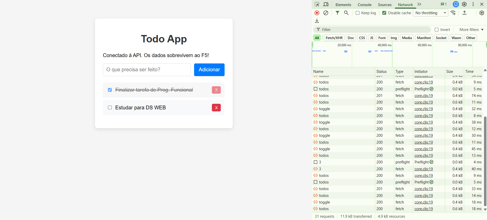

# 📝 Todo List — Clojure/ClojureScript

**Tutorial original:** [Tutorial Clojure/ClojureScript: Construindo uma Aplicação Persistente e Reativa](https://lambdageo-edu.github.io/lambdageo-tutorials/clojure/)

## Descrição

Aplicação full-stack de lista de tarefas (Todo List), construída de forma incremental para estudar a arquitetura de aplicações funcionais modernas:

- **Backend:** Clojure, com [Ring](https://github.com/ring-clojure/ring) (servidor Jetty) e [Reitit](https://github.com/metosin/reitit) (roteamento), expondo uma API REST com CRUD completo.
- **Banco de dados:** SQLite, acessado via [next.jdbc](https://github.com/seancorfield/next-jdbc), com persistência real em disco (`prod.db`).
- **Frontend:** ClojureScript com [Reagent](https://github.com/reagent-project/reagent) (React) e [Shadow-CLJS](https://github.com/thheller/shadow-cljs), consumindo a API via `fetch`.

## Pré-requisitos

| Ferramenta                                                        | Versão mínima |
| ----------------------------------------------------------------- | ------------- |
| Java (JDK)                                                        | 11+           |
| [Clojure CLI](https://clojure.org/guides/install_clojure) (`clj`) | 1.11+         |
| Node.js (`node` / `npm`)                                          | 18+           |

## Como Rodar

1. **Clone o repositório e instale as dependências do frontend:**

   ```bash
   git clone [https://github.com/ZuzaNeto/todo-app.git](https://github.com/ZuzaNeto/todo-app.git)
   cd todo-app
   npm install
   ```

2. **Terminal 1 — Backend (API na porta 3000):**

   ```bash
   clj -M:run
   ```

   Na primeira execução, as dependências Clojure serão baixadas e o banco `prod.db` será criado automaticamente.

3. **Terminal 2 — Frontend (porta 8000):**

   ```bash
   npx shadow-cljs watch app
   ```

   Aguarde a mensagem `Build completed`.

4. **Abra o navegador em:** [http://localhost:8000](http://localhost:8000)

## Endpoints da API

| Método   | Rota                    | Descrição                            |
| -------- | ----------------------- | ------------------------------------ |
| `GET`    | `/api/todos`            | Lista todas as tarefas               |
| `POST`   | `/api/todos`            | Cria uma tarefa (`{"title": "..."}`) |
| `POST`   | `/api/todos/:id/toggle` | Alterna o status feito/não feito     |
| `DELETE` | `/api/todos/:id`        | Remove uma tarefa                    |

## Aba Rede do navegador



## 👥 Créditos

**Aluno:** José Nunes de Sousa Neto — Matrícula: **20250071231**

**Disciplina:** EECP0047 - TÓPICOS EM ENGENHARIA DA COMPUTAÇÃO II - INTRODUÇÃO A PROGRAMAÇÃO FUNCIONAL 

**Professor:** Prof. Dr. Sergio Souza Costa  

**Instituição:** UFMA — Universidade Federal do Maranhão  

**Semestre:** 2026.2

---

<div align="center">

**Este repositório possui fins acadêmicos.**

</div>

---
